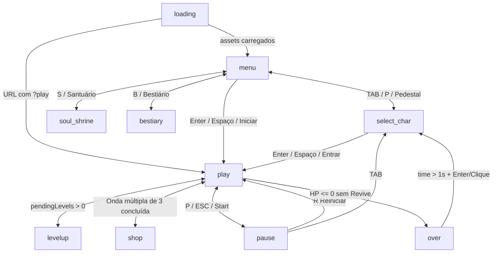

# ⚔️ Underground — Documentação Técnica e de Design Completa

> **Documento mestre de arquitetura, sistemas, balanceamento, catálogo de conteúdo, auditoria técnica e roadmap de melhorias do projeto `-UnderGame` (edição 2D).**  
> Todos os números, fórmulas, constantes, caminhos de arquivos e comportamentos descritos abaixo foram extraídos diretamente do código-fonte atual do repositório.

---

## 📑 Sumário

1. [Identidade, Visão Geral & Métricas do Projeto](#1-identidade-visão-geral--métricas-do-projeto)
2. [Loop de Jogo, Máquina de Estados & Dificuldades](#2-loop-de-jogo-máquina-de-estados--dificuldades)
3. [Arquitetura Técnica & Pipeline de Execução](#3-arquitetura-técnica--pipeline-de-execução)
4. [Campeões Jogáveis](#4-campeões-jogáveis)
5. [Sistema de Combate, Física & Fórmulas Matemáticas](#5-sistema-de-combate-física--fórmulas-matemáticas)
6. [Bestiário Completo: Inimigos, Elites e Chefes](#6-bestiário-completo-inimigos-elites-e-chefes)
7. [Progressão Roguelite: Melhorias, Sinergias, Loja & Reforja](#7-progressão-roguelite-melhorias-sinergias-loja--reforja)
8. [Mundo Procedural, Biomas, Eventos, Props, Altares & Coletáveis](#8-mundo-procedural-biomas-eventos-props-altares--coletáveis)
9. [Meta-Progressão, Bestiário & Sistema de Save](#9-meta-progressão-bestiário--sistema-de-save)
10. [Interface (HUD & Menus), Controles, Áudio & Inventário de Assets](#10-interface-hud--menus-controles-áudio--inventário-de-assets)
11. [Auditoria Técnica: Bugs Conhecidos, Inconsistências & Dívida Técnica](#11-auditoria-técnica-bugs-conhecidos-inconsistências--dívida-técnica)
12. [Roadmap Detalhado de Possíveis Melhorias](#12-roadmap-detalhado-de-possíveis-melhorias)

---

## 1. Identidade, Visão Geral & Métricas do Projeto

| Propriedade | Valor / Descrição |
| :--- | :--- |
| **Nome no Jogo / UI** | `UNDERGROUND — Crônicas da Arena Ancestral` *(título HTML: `Underground Game 2.0`; `README.md`: `Underground II`, scripts `?v=2.1.0`)* |
| **Gênero** | Roguelite de Ação Top-Down / Arena Survival / Hack & Slash 2D |
| **Estética** | Pixel Art com interface Medieval Dark Fantasy (ardósia, ferro forjado, pergaminho e ouro ancestral) |
| **Plataformas Suportadas** | Navegadores Desktop e Mobile (Teclado + Mouse, Gamepad Plug & Play e Touchscreen adaptativo) |
| **Stack Tecnológica** | HTML5 Canvas 2D + Vanilla JavaScript (ES6+, escopo global modularizado) + CSS3 + Web Audio API + Gamepad API + LocalStorage |
| **Dependências Externas** | Nenhuma (`0` pacotes npm, `0` bundlers; roda via HTTP local ou `file://` dependendo de políticas de áudio/autoplay do navegador) |

### Métricas do Repositório (`-UnderGame`)

- **Código-fonte:** `7.892` linhas totais distribuídas em `18` arquivos (`348.589` bytes):
  - `src/`: `16` scripts JavaScript (`7.298` linhas, `332.176` bytes / ~324 KB)
  - `css/style.css`: `473` linhas (`10.917` bytes)
  - `index.html`: `121` linhas (`5.496` bytes)
- **Assets (`assets/`):** `108` arquivos totais:
  - Músicas (`assets/audio/music/`): `3` arquivos `.mp3`
  - Efeitos sonoros (`assets/audio/sfx/`): `26` arquivos (`20` `.wav` + `6` `.ogg`)
  - Tipografia (`assets/fonts/`): `1` fonte `.ttf` (`PressStart2P.ttf`)
  - Ícones (`assets/icons/`): `46` arquivos `.png`
  - Sprites de campeões (`assets/sprites/characters/`): `7` arquivos `.png`
  - Sprites de monstros e chefes (`assets/sprites/monsters/`): `17` arquivos `.png`
  - Tiles e props do mundo (`assets/sprites/world/`): `8` arquivos `.png`

---

## 2. Loop de Jogo, Máquina de Estados & Dificuldades

### 2.1 Máquina de Estados (`state`)

Embora o comentário em `src/systems/state.js:4` liste 8 valores, `src/main.js` e `src/ui/menus.js` operam **10 estados reais**:

| Estado | Função Principal | Entrada | Saídas Possíveis |
| :--- | :--- | :--- | :--- |
| `loading` | Exibe barra/percentual de carregamento (`loaded / total * 100`) | Boot inicial em `state.js:4` | `menu` (padrão) ou `play` (se URL contiver `?play`, via `main.js:31`) |
| `menu` | Câmera orbitando a arena + pedestal 3D do campeão + overlay HTML `#menu-overlay` | Fim do `loading`, `[ESC]`/`Voltar` dos submenus | `play` (`Enter`/`Espaço`/`#btn-play`), `select_char` (`TAB`/`P`/clique), `soul_shrine` (`S`), `bestiary` (`B`) |
| `select_char` | Roleta Cilíndrica 3D de campeões com trilha exclusiva por herói | `TAB`, `P` ou clique no botão/pedestal | `play` (`Enter`/`Espaço`/botão), `menu` (`ESC`) |
| `soul_shrine` | Loja permanente usando Essências Abissais | Tecla `S` ou botão `#btn-souls` | `menu` (`ESC`, `S`, `Enter` ou Voltar) |
| `bestiary` | Livro paginado (27 páginas) com sprite animado, stats, lore e contador de abates | Tecla `B` ou botão `#btn-bestiary` | `menu` (`ESC`, `B` ou Fechar) |
| `play` | Simulação ativa em arena top-down (ondas, combate, altares, coletáveis) | Iniciar partida ou retomar pausa/levelup/loja | `levelup`, `shop`, `pause` (`P`/`ESC`/`Start`), `select_char` (`TAB`), `over` (HP <= 0 sem revive) |
| `levelup` | Seleção de 1 entre 3 bênçãos (`UPGRADES`), com Reroll (`R`) e Banimento (`X`) | `player.pendingLevels > 0 && !p.ult` | `play` (ou próximo `levelup` na fila) |
| `shop` | Bazar do Mercador Errante (9 itens com inflação por compra) | Fim de ondas múltiplas de 3 (`3, 6, 9...`) | `play` (`Enter`/`ESC`/`B`/`Start`/botão continuar) |
| `pause` | Suspende simulação; mostra seed, onda, abates e ouro | `P`, `ESC`, `Start` ou botão touch `⏸` | `play`, `select_char` (`TAB`), `play` reiniciado (`R`) |
| `over` | Pergaminho de resumo final da jornada, causa da queda e atualização de recorde | `hurtPlayer` zera HP sem `revivesLeft` | `select_char` (`Enter` ou clique após `time > 1s`) |

### 2.2 Modos de Dificuldade (`DIFFICULTY_MODES`)

Definidos em `src/systems/state.js:21-27`, salvos na chave `gabriel_diff` (e no perfil v2). **Pesadelo (`id: 2`) é o padrão inicial.**

| ID | Nome | Multiplicador HP (`hpMul`) | Multiplicador Vel. (`spdMul`) | `spawnMul` *(definido)* | Multiplicador Score (`scoreMul`) | Cor HUD | Descrição |
| :-: | :--- | :-: | :-: | :-: | :-: | :-: | :--- |
| `0` | **NORMAL** | `1.0x` | `1.0x` | `1.0x` | `1.0x` | `#7aff61` | Equilíbrio Clássico |
| `1` | **DIFÍCIL** | `1.45x` | `1.15x` | `1.25x` | `1.5x` | `#ffaa2b` | +45% Vida • +50% Pts |
| `2` | **PESADELO** *(padrão)* | `2.1x` | `1.3x` | `1.5x` | `2.25x` | `#ff4268` | 2.1x Vida • +125% Pts |

> **Nota técnica:** `spawnMul` existe nos objetos de `DIFFICULTY_MODES`, mas atualmente não é referenciado em `src/systems/update.js` ou `src/systems/combat.js` (veja [Seção 11](#11-auditoria-técnica-bugs-conhecidos-inconsistências--dívida-técnica)).

---

## 3. Arquitetura Técnica & Pipeline de Execução

### 3.1 Inventário de Módulos (Ordem de Carregamento)

Os scripts são carregados sequencialmente em `index.html:94-119` compartilhando escopo global (sem `type="module"`), com cache-busting `?v=2.1.0`:

| Ordem | Arquivo | Linhas | Bytes | Responsabilidade Principal |
| :-: | :--- | --: | --: | :--- |
| — | `index.html` | 121 | 5.496 | Estrutura base (`<canvas id="game">`), overlay HTML `#menu-overlay` e carregamento dos 16 scripts |
| — | `css/style.css` | 473 | 10.917 | Fonte pixel art `@font-face`, viewport `100dvh`, `image-rendering: pixelated`, `prefers-reduced-motion`, estilos e transições do `#menu-overlay` |
| 1 | `src/core/config.js` | 57 | 2.397 | Canvas/contexto 2D, dimensões `W/H`, helpers (`clamp`, `dist`, `angDiff`, `rand`, `randi`, `pick`), `getCamZoom()`, paleta `SABER_COLORS` |
| 2 | `src/core/assets.js` | 80 | 3.550 | `IMAGE_LIST` (78 chaves), pré-carregamento assíncrono de imagens e fonte, geração das máscaras brancas `WHITE[]` (`makeWhite`) e `buildWorld()` |
| 3 | `src/core/audio.js` | 177 | 7.842 | Pré-carga dos 26 SFX com cooldown anti-spam de `40ms` e variação de pitch; gerenciador de músicas por campeão (`charAudioMap`); sintetizador WebAudio (`beep`); objeto `SFX` (34 ações) |
| 4 | `src/core/input.js` | 590 | 19.613 | Teclado (`keys`/`pressed`), Mouse, Joystick/botões Touch adaptativos, Gamepad Plug & Play (`applyRadialDeadzone`, auto-repeat, dual-rumble, toast) e `actionBuffer` (140ms) |
| 5 | `src/data/characters.js` | 114 | 9.704 | Tabelas de animação pixel-perfect (`ANIM_MANGUINHA`, `ANIM_AMXRAL`, `ANIM_TUIUBA`), definição `CHARACTERS` e `drawCharacterFrame()` |
| 6 | `src/data/monsters.js` | 229 | 13.778 | Tabela `MON` (27 arquétipos), `BESTIARY_LORE`, `BESTIARY_ORDER`, `isBossType()` e gerador de distribuição de onda `wavePool()` |
| 7 | `src/data/items.js` | 83 | 11.663 | Catálogo `UPGRADES` (27 melhorias), `TERRARIA_PREFIXES` (8 prefixos), `rollTerrariaPrefix()` e `SHOP_ITEMS` (9 itens com inflação) |
| 8 | `src/world/world.js` | 176 | 8.501 | Arena `WORLD` (`2400×1824`), mapa offscreen `ground`, `blocked()`, `buildWorld()`, `refillBarrels()`, `SHRINE_TYPES` (6 altares), `triggerExplosion()`, `collideStatic()` |
| 9 | `src/systems/state.js` | 147 | 7.291 | Estado global da partida, `BIOMES` (4), `DIFFICULTY_MODES` (3), sistema `saveProfile()` / `loadProfile()` (`SAVE_VERSION = 2`), `generateRunSeed()`, `reset()` |
| 10 | `src/systems/combat.js` | 734 | 34.075 | `spawnPos()`, `spawnEnemy()` (escalonamento e elites), `damageEnemy()`, `killEnemy()`, `gainXp()`, Level Up/Reroll/Ban, loja `buyShopItem()`, `startAttack()`, `hitBarrel()`, `collect()`, `hurtPlayer()`, `gameOver()` |
| 11 | `src/systems/ai.js` | 732 | 30.736 | `updateEnemy()` (18 IAs de mobs + elites + Nova Rúnica) e 9 máquinas de estado individuais para os chefes |
| 12 | `src/systems/update.js` | 844 | 40.346 | Simulação principal por frame: ondas, eventos, meteoros/estrelas, altares, movimento, esquiva/afterimages, ataques, Ultimate, 10 habilidades passivas, poças/totens, projéteis, coletáveis, partículas e câmera |
| 13 | `src/render/worldRenderer.js` | 810 | 36.503 | Renderização de mapa, props, altares, avisos de perigo, inimigos, jogador, sabre/projéteis/raios, poças, atmosfera ambiental, culling, ordenação por eixo Y, iluminação dinâmica e flashes |
| 14 | `src/ui/hud.js` | 1100 | 48.728 | Sistema visual Medieval Dark Fantasy com cache offscreen (`hudPanelCache`), 10 elementos de HUD + controles Touch renderizados no Canvas |
| 15 | `src/ui/menus.js` | 1145 | 52.720 | Telas de `levelup`, `shop`, Roleta Cilíndrica 3D (`drawCharacterSelect`), Bestiário em livro, Santuário das Almas, vínculo com `#menu-overlay`, Pausa e Game Over |
| 16 | `src/main.js` | 280 | 12.829 | Loop `requestAnimationFrame` (`loop`), roteamento de input e desenho por estado, proteção `try/catch` de canvas e limpeza dos flags de 1 frame |

### 3.2 Game Loop, Câmera e Renderização

- **Passo de Tempo (`src/main.js:4`):** `dt = Math.min(0.033, (now - last) / 1000)`, limitando saltos de frame para manter física e colisões estáveis até em abas desaceleradas (piso efetivo de ~30 fps por tick).
- **Hit-Stop (`freeze`):** Quando `state === 'play'` e `freeze > 0`, `update(dt)` é pausado temporariamente enquanto `freeze`, `shake` (`-50/s`) e `trauma` (`-2.5/s`) decaem (`main.js:144`).
- **Blindagem contra Travamento Visual (`main.js:271-275`, `worldRenderer.js:640-752`):** Blocos `try/catch/finally` garantem `ctx.setTransform(1, 0, 0, 1, 0, 0)`, `globalCompositeOperation = 'source-over'` e `globalAlpha = 1` caso ocorra exceção no frame.
- **Zoom Responsivo (`src/core/config.js:13-27`):**
  - Paisagem mobile (`H <= 450`): `clamp(H / 540, 0.65, 0.76)`
  - Retrato estreito (`W <= 480`): `clamp(W / 560, 0.70, 0.82)`
  - Telas médias (`H <= 620`): `clamp(H / 660, 0.80, 0.92)`
  - Desktop padrão: `1.0`
- **Câmera Suave + Look-Ahead + Trauma (`src/systems/update.js:827-841`, `worldRenderer.js:633-643`):**
  - *Look-Ahead*: deslocamento alvo na direção `p.aim` de `42px` em movimento (`16px` parado), reduzido para `0.75x` no eixo Y, interpolado com taxa exponencial `1 - exp(-6.5 * dt)`.
  - *Follow*: persegue `(p.x + cam.lookX, p.y - 40 + cam.lookY)` com `1 - exp(-9.0 * dt)` e limita aos cantos via `clampCam()`.
  - *Trauma*: `shakeOffset = trauma^2 * 7`, gerando oscilação senoidal (`sin(time * 38)` / `cos(time * 32)`), com decaimento `trauma -= 3.5 * dt`.
- **Pipeline de Desenho (`worldRenderer.js`):**
  1. Limpa tela e aplica transformação de câmera arredondada (`Math.round`) para preservar nitidez pixel-perfect.
  2. Desenha fundo base `#1d4220` + textura pré-renderizada `ground` (`2400×1824`).
  3. Desenha poças (`puddles`), altares (`shrines`), telegrafias/meteoros (`hazards`), aura de gelo e `pickups`.
  4. Executa **Frustum Culling** (`vis()`) e ordena árvores, rochas, props, inimigos e jogador pelo eixo `y` (`Y-sorting`). Copas de árvores ganham `globalAlpha = 0.5` quando o jogador está imediatamente atrás (`worldRenderer.js:15-18`).
  5. Desenha bolas de fogo orbitais, poeira ambiental (`ambientDust`, cap 35), arcos de sabre, projéteis e raios em composição aditiva (`lighter`), anéis expansivos (`fxRings`, cap 30), partículas quadradas (cap 400) e textos de dano/evento com curva de pop (cap 45).
  6. Aplica máscara radial de **Iluminação Dinâmica** ao redor do jogador com tint do bioma, borda temática por evento (`bloodmoon`, `void_eclipse`, `magma_surge`), aura colorida ao redor do chefe, vinheta vermelha pulsante quando `hp <= 2` e flash vermelho imediato após sofrer dano.

---

## 4. Campeões Jogáveis

Definidos em `src/data/characters.js:40-89`, com animações por âncora explícita `(ax, ay)` nos frames (`idle`, `idleSide`, `idleUp`, `walkDown`, `walkSide`, `walkUp`, `spin`, `attack`).

| Campeão | Título | Arma (`weaponType`) | HP Base | Vel. Base (`220 * speedMod`) | Dano Base | Escala | Trilha Tema |
| :--- | :--- | :--- | :-: | :-: | :-: | :-: | :--- |
| **Manguinha** | Garoto Comum | `saber` — Corte de Sabre | `6` *(3 corações)* | `220.0 px/s` (`1.00x`) | `1` | `1.60x` | `Manguinha.mp3` |
| **Amxral** | Estrela do Bloco | `star` — Estrela Cintilante | `6` *(3 corações)* | `237.6 px/s` (`1.08x`) | `1` | `1.10x` | `amxral.mp3` |
| **Tuiuba** | Orange Jui | `orange` — Tiro de Laranja | `6` *(3 corações)* | `246.4 px/s` (`1.12x`) | `1` | `1.18x` | `tuiuba.mp3` |

### Detalhes de Mecânicas e Passivas por Campeão

1. **Manguinha (`saber`):**
   - **Ataque Básico:** Duração base `0.32s / rateMul`. Golpe em arco melee com alcance base `96 * stats.range` e semicone `1.38 + (stats.multi || 0) * 0.35` radianos (ou qualquer alvo a `< 32px`). Enquanto ataca com o sabre, sua velocidade de movimento cai para `0.62x` (`update.js:333`).
   - **Escalonamento de Ataque Múltiplo (`multi`):**
     - `multi >= 1`: adiciona um arco visual extra deslocado em `+0.45 rad`.
     - `multi >= 2`: adiciona outro arco em `-0.45 rad` e concede **`+1` de dano melee**.
     - `multi >= 3`: adiciona corte nas costas (`a + Math.PI`) com hitbox traseira de `1.1 rad`.
   - **Passiva Exclusiva — Rebatida de Sabre (`combat.js` / `update.js:430-442`):** Todos os `ebullets` dentro do arco de corte (`r + 14px`) são interceptados e convertidos em orbes aliados na direção `p.aim` com `1.65x` velocidade, dano `stats.dmg * 2 + 2` e perfuração `3`. Cada rebatida concede **`+15` pontos**, **`+10% * furyMul` de Fúria** e **reduz o cooldown atual do Giro em `0.35s`**.
   - **Personalização do Sabre (`[C]`):** Alterna entre 5 cores (`SABER_COLORS` em `config.js:49-55`): Azul Celeste (`#3aa2ff`), Verde Esmeralda (`#3aff75`), Roxo Estelar (`#c844ff`), Laranja Flamejante (`#ff7728`) e Rubi Sith (`#ff264a`).
   - **Ultimate — Fúria do Sabre (`2.6s`, tick `0.12s`):** Invulnerável; gera cortes gigantes aleatórios em raio `200 * range`, causa `stats.dmg` em todos os inimigos na área por tick, destrói barris e apaga projéteis inimigos.

2. **Amxral (`star`):**
   - **Ataque Básico:** Duração base `0.25s / rateMul`. Dispara estrelas douradas a `590 * min(1.5, 0.85 + range * 0.15) px/s`, raio `16 * range`, dano `stats.dmg + 1`, perfuração `2`, vida `1.25s` (leque de `1 + multi` projéteis com passo `0.16 rad`).
   - **Passiva Exclusiva — Mira Estelar (`combat.js:460-472`):** Contador interno `p.shotCount`. **A cada 5º disparo**, arremessa **Estrelas Gigantes Empoderadas** com velocidade `680 * min(...)`, raio `26 * range`, **`2x` dano (`(stats.dmg + 1) * 2`)** e perfuração `5`.
   - **Ultimate — Chuva Estelar (`2.6s`, tick `0.12s`):** Dispara **4 estrelas por tick** (~84 no total) em ângulos aleatórios (`600 px/s`, raio `20 * range`, dano `stats.dmg + 2`, perfuração `3`), além de destruir projéteis inimigos em `R = 200 * range`.

3. **Tuiuba (`orange`):**
   - **Ataque Básico:** Duração base `0.25s / rateMul`. Lança laranjas a `570 * min(1.5, 0.85 + range * 0.15) px/s`, raio `16 * range`, dano `stats.dmg + 1`, perfuração `1`, vida `1.3s`.
   - **Impacto Explosivo & Poças Cítricas (`update.js:765-775`):** Ao atingir inimigo, explode num splash cítrico em área (`72 * range`) causando `round(s.dmg * 0.6)` de dano nos alvos ao redor e cria uma **poça cítrica** (`r = 42 * range`, duração `2.0s`, limite global de 18 poças) que aplica `slow 0.45s` e `1` de dano a cada `0.45s`.
   - **Passiva Exclusiva — Impulso Cítrico (`update.js:331-332`):** Ao pisar dentro de qualquer poça cítrica própria (`dist < pd.r + 16`), Tuiuba ganha **`+24%` de velocidade de movimento (`1.24x`)**.
   - **Ultimate — Explosão Cítrica (`2.6s`, tick `0.12s`):** Dispara **5 laranjas por tick** (~105 no total) em `360°` (`620 px/s`, raio `18 * range`, dano `stats.dmg + 2`), cobrindo a arena de explosões e poças cítricas.

---

## 5. Sistema de Combate, Física & Fórmulas Matemáticas

### 5.1 Movimentação, Esquiva (`dash`) e Action Buffer

- **Velocidade Efetiva do Jogador (`update.js:328-333`):**
  $$\text{speed} = \text{stats.speed} \times \text{Frenesi}(1.3) \times \text{Crise}_{HP \le 2}(1.14) \times \text{Slow}(0.72) \times \text{Poça Cítrica}(1.24) \times \text{SabreAtacando}(0.62)$$
- **Giro / Esquiva (`update.js:314-374`):**
  - Duração: `0.30s` | Velocidade: `650 px/s` | Invencibilidade concedida: `0.36s` | Cooldown base: `0.95s`.
  - Causa `stats.dashDmg` (`2` base) com knockback `520` em inimigos num raio de `e.r + 38` e acerta barris em `b.r + 34`.
  - **Esquiva Perfeita:** Ao atravessar projéteis inimigos (`dist < eb.r + 28`), destrói os projéteis e concede **1x por esquiva**: **`+15% * stats.furyMul` de Fúria**, **`+50` pontos**, nova visual ciano e *rumble*.
- **Action Buffer (`src/core/input.js:338-353`):** Armazena inputs discretos de `attack`, `dash` e `ult` por **`140 ms` (`0.14s`)** antes de o cooldown ou animação terminar, disparando imediatamente quando liberado.

### 5.2 Pipeline de Cálculo de Dano no Inimigo (`damageEnemy` — `combat.js:75-167`)

A execução segue exatamente esta ordem:

1. **Bloqueios de Invulnerabilidade:** Ignora dano se `e.dead`, `e.spawn > 0`, `e.invul` (Leviatã enterrado), `e.burrowed` ou `e.faded` (`ghost` / `necro_boss` intangíveis).
2. **Crítico:** Se `!opts.noCrit`, chance = `stats.crit + (prefix?.critAdd || 0)`. Dano `*= 2`.
3. **Prefixo de Arma (Terraria):** Se `!opts.noCrit`, `dmg = Math.max(1, Math.round(dmg * prefix.dmgMul))`. Prefixo **Mítico** recarrega `+0.6 * furyMul` de Fúria por acerto.
4. **Multiplicadores de Relíquias:**
   - **Joia do Poder (`infPower`):** `ceil(dmg * (1 + 0.25 * nivel))` (+ nova cósmica roxa `maxR: 95` em críticos).
   - **Orbe de Sangue (`bloodOrb`):** se `player.hp <= maxHp * 0.5`, `ceil(dmg * (1 + 0.20 * nivel))`.
5. **Reduções Defensivas do Alvo:**
   - **Lich do Crepúsculo com Escudos (`lichShields > 0`):** dano multiplicado por **`0.35x`**; após 4 acertos, quebra 1 escudo.
   - **Elite Encouraçado (`armored`):** dano multiplicado por **`0.75x`**.
   - **Golem com Escudo Ativo (`shieldOn`):** se `!opts.ignoreShield`, dano `*= 0.40x` e knockback `*= 0.25x`.
6. **Proteção Anti-One-Shot em Chefes (`combat.js:110-113`):**
   - Limite suave `maxHit = Math.max(12, Math.ceil(e.maxHp * 0.07))`. Se `dmg > maxHit`, o excedente é reduzido para `20%`: `dmg = maxHit + Math.ceil((dmg - maxHit) * 0.2)`.
7. **Fúria do Chefe (`Enraged`):** Ao cair para `<= 50%` HP pela primeira vez, ativa onda de choque (`220px`) e `SFX.bossAwake()`.
8. **Efeitos Pós-Dano:** Aplica Veneno (`3.2 + venom*0.5` s), Knockback (resistências: Chefes `0.015x`, Golem/Bigworm/Flower `0.18x`, Slime Grande `0.40x`, padrão `1.0x`), **Impacto Arcano (`critNova`)** (em críticos, `75 + critNova*20 px` com `40% * critNova` de dano), **Cristal de Eco (`ricochet`)** (`24% * nivel` de chance de saltar a `240px` com `65%` de dano), Hit-stop (`0.03s` crítico / `0.015s` normal) e trauma apenas em `heavyImpact` ou crítico em Chefe.

### 5.3 Pipeline de Dano no Jogador (`hurtPlayer` — `combat.js:657-723`)

Ordem exata de resolução quando o jogador é atingido (`player.inv === 0 && !player.ult && state === 'play'`):

1. **Escudos Orbitais (`p.shields > 0`):** Consome `1` escudo, concede `0.75s` i-frames, dispara nova ciano em `135px` causando `2 + (stats.aegis || 0) * 2` de dano e retorna sem perder vida.
2. **Poção de Espinhos (`p.thornsT > 0`):** Reflete `Math.max(2, dmg * 2 + stats.dmg)` em todos os inimigos a `< 110 + e.r` (ou `< 95 + e.r` da origem do dano).
3. **Poção Pele de Ferro (`p.ironskinT > 0`):** Dano `> 1` cai pela metade (`floor(dmg * 0.5)`); dano `== 1` tem **`50%` de chance** de ser totalmente bloqueado (`0.65s` i-frames).
4. **Jaqueta Blindada (`stats.armor`):** Se `dmg > 1`, chance de `armor * 25%` de reduzir o dano em `1`.
5. **Aplicação de Dano:** Subtrai HP, ativa `stats.invTime` (`1.0s` base + `0.3s/nv` de Armadura), **zera o Combo**, aplica knockback fixo de `28px` no jogador e causa `0.25` de trauma + rumble.
6. **Segunda Chance (`stats.revivesLeft > 0`):** Se `hp <= 0`, consome o revive, restaura `ceil(maxHp * 0.5)` HP (mínimo `2`), concede `2.4s` de i-frames e explode em raio `260px` causando `25 + stats.dmg * 4` de dano. Caso contrário, aciona `gameOver()`.

### 5.4 XP, Combo & Escalonamento de Ondas

- **XP Necessário por Nível (`combat.js:309`):** Nível 1 -> 2 requer **`6` XP**. Do nível 2 em diante:
  $$\text{xpNext}(L) = \lfloor 12 + 6.5L + L^{1.72} \rfloor$$
- **Sistema de Combo (`update.js:278-279`, `combat.js:185-204`):**
  - Tempo de expiração: `2.9s` sem abates.
  - Multiplicador de pontuação por abate: `1 + Math.floor(combo / 10) * 0.25`.
  - Títulos visuais no HUD (`hud.js:645`): `3+` COMBO, `10+` FEROZ, `20+` BRUTAL, `40+` LENDÁRIO.
  - **Marcos de Sequência (`STREAK_CALLS`):** 15 abates (`+4` moedas), 30 (`+8`), 50 (`+15`), 80 (`+25`), 120 (`+40`), mais `cnt * 5` pontos.
- **Quantidade e Limite de Spawns por Onda (`update.js:27, 107-117`):**
  - `toSpawn`: `16 + floor(wave * 4.8)` (normal) ou `15 + floor(wave * 2.5)` (onda de chefe). Evento `swarm` multiplica por `1.35x`.
  - Limite simultâneo em tela (`cap`): `(swarm ? 78 : 58) + wave * 4`.
  - Intervalo entre grupos (`spawnTimer`): `max(0.09, 0.56 - wave * 0.042)` segundos (`0.6x` em `swarm`).
- **Escalonamento Composto de Monstros (`combat.js:38-65`):**
  - `attrScale` (acompanha build do jogador): `(level - 1) * 0.14 + (dmg - 1) * 0.22 + (atkRate - 1) * 0.35`.
  - `hpScale`: `(1.25 + (wave - 1) * 0.38 + max(0, wave - 2)^1.68 * 0.20 + attrScale) * diff.hpMul`.
  - `spdScale`: `(1.12 + min(wave, 30) * 0.035 + min(0.45, (level - 1) * 0.025)) * diff.spdMul` *(×1.28 minislime, ×1.18 swarm, ×1.22 bloodmoon)*.
  - `scaledDmg`: `d.dmg + (wave>=5 ? 1 : 0) + (wave>=10 && (elite||boss) ? 1 : 0) + (wave>=16 ? 1 : 0) + (bloodmoon ? 1 : 0)`.
  - `bossWaveScale`: `1.35 + max(0, wave - 5) * 0.25 + max(0, bossCount - 1)^1.3 * 0.45 + ((level - 1)*0.09 + (dmg - 1)*0.16)`, aplicada sobre `d.hp + (bossCount - 1) * 160`.

---

## 6. Bestiário Completo: Inimigos, Elites e Chefes

O jogo cataloga **27 entradas principais** no Bestiário (`18` mobs comuns/especiais + `9` chefes), além de `2` variações de Slime (`bigslime` e `minislime`).

> **Mecânica Global de Investida (`ai.js:28-36`):** Todo inimigo comum (exceto chefes, `flower` e `goblin`) que esteja entre `55px` e `210px` de distância pode realizar um pequeno salto/investida (*lunge*) de impulso `320` com recarga de `2.2–4.2s`.

### 6.1 Inimigos Regulares & Variantes

| ID (`MON`) | Nome no Bestiário | HP | Vel. | Raio | Dano | XP | Pts | Voa? | Onda Min. (`wavePool`) | Comportamento de IA |
| :--- | :--- | --: | --: | --: | --: | --: | --: | :-: | :-: | :--- |
| `slime` | Slime Ácido | 3 | 75 | 15 | 1 | 1 | 10 | Não | 1 | Pula em arcos periódicos (`hop * 1.9x`) |
| `bigslime` | *(Variante Slime Grande)* | `10` | 75 | `25.5` | 1 | 1 | 35 | Não | 4 | `1.7x` escala, `3.5x` HP; ao morrer gera **3 `minislime`** |
| `minislime` | *(Variante Mini-Slime)* | `1` | `96` | `10.5` | 1 | 1 | 4 | Não | Drop | `0.7x` escala, `0.36x` HP, `1.28x` velocidade |
| `worm` | Verme das Cavernas | 2 | 85 | 12 | 1 | 1 | 8 | Não | 1 | Perseguição direta em enxame |
| `bat` | Morcego Sombrio | 1 | 150 | 12 | 1 | 1 | 12 | Sim | 2 | Voo rápido errático (`cos/sin` `90 px/s`), ignora obstáculos |
| `snake` | Serpente Rasteira | 3 | 110 | 14 | 1 | 2 | 15 | Não | 2 | Avanço direto ágil para flanqueio |
| `chaos_imp` | Diabrete do Caos | 8 | 125 | 14 | 2 | 3 | 35 | Sim | 2 | Voo com oscilação (`45 px/s`); dispara faíscas laranja (`230 px/s`) |
| `bee` | Abelha Ferrão | 2 | 110 | 12 | 1 | 2 | 15 | Sim | 3 | Telegrafa `!` por `0.45s` e dá investida rápida a `430 px/s` |
| `bomber` | Slime Volátil | 4 | 138 | 15 | 2 | 3 | 30 | Não | 3 | Corre em alta velocidade; arma bomba meteoro (`r=72`) ao chegar perto (`<52px`) ou ao morrer (`r=68`) |
| `void_spider` | Aranha do Vazio | 12 | 140 | 16 | 2 | 4 | 40 | Não | 3 | A cada `1.8–2.8s` salta (`1.8x` vel. por `0.45s`) na direção do herói |
| `eyeball` | Olho Errante | 3 | 85 | 14 | 1 | 2 | 20 | Sim | 4 | Mantém distância (`200–330px`) circulando lateralmente e atira projéteis (`230 px/s`) |
| `viper` | Víbora Abissal | 5 | 132 | 14 | 1 | 3 | 32 | Não | 4 | Zigue-zague amplo (`±115 px/s`) e deixa **poças de ácido** (`r=28`, `2.6s`) |
| `carminite_ghast` | Ghast de Carminita | 10 | 112 | 15 | 2 | 4 | 42 | Sim | 4 | Orbita a ~`210px` e dispara leque triplo de fogo (`235 px/s`) a cada `2.1s` |
| `ghost` | Espectro Errante | 5 | 95 | 16 | 1 | 3 | 25 | Sim | 6 | Fica intangível e semi-invisível (`faded`) durante `1.4s` a cada ciclo de `5s` |
| `flower` | Planta Carnívora | 14 | 0 | 24 | 1 | 6 | 60 | Não | 6 | Enraizada; abre e cospe anel de **8 esporos verdes** (`160 px/s`) |
| `sniper` | Olho Atirador | 5 | 75 | 15 | 2 | 4 | 40 | Sim | 6 | Para à distância, trava **mira laser vermelha** por `0.75s` e dispara tiro rápido (`420 px/s`) |
| `bigworm` | Verme Colossal | 15 | 48 | 22 | 2 | 6 | 60 | Não | 7 | Alta resistência (resistência a knockback `0.18x`) e rajada tripla roxa (`190 px/s`) |
| `necromancer` | Necromante | 9 | 72 | 18 | 1 | 5 | 55 | Sim | 7 | Mantém distância, dispara 2 projéteis (`210 px/s`) e **invoca** `bat`/`minislime`/`worm` (se `<55` mobs) |
| `golem` | Golem Abóbora | 45 | 58 | 24 | 2 | 12 | 120 | Não | 9 | Tanque com escudo cíclico (`60%` menos dano por `1.9s` a cada `4.5s`) e anel de 6 tiros (`<220px`) |
| `goblin` | Goblin Tesoureiro | 28 | 172 | 16 | 0 | 15 | 350 | Não | 2+ *(evento)* | Foge do herói por `16s`, soltando moedas (`0.85s`). Abate dá **Jackpot** (18 moedas, 4 rubis, poção, orbe) |

### 6.2 Modificadores de Elite (`ELITE_TRAITS`)

Surgem naturalmente a partir da **Onda 4** (`5% + 1%` por onda até teto de `22%`; `18%` na *Lua de Sangue*; `28%` na *Onda Dourada*) ou forçados em eventos (`cursed`, `bounty`). Possuem **`1.32x` tamanho**, **`2.9x` HP** (`3.8x` se Encouraçado), **`2.4x` XP** e garantem **+4 moedas + 1 poção**.

| Traço | Rótulo na UI | Cor | Efeito Especial |
| :--- | :--- | :-: | :--- |
| `vampiric` | `VAMPÍRICO` | `#ff4268` | Ao causar dano no jogador, cura `max(2, ceil(maxHp * 0.1))` de vida |
| `teleporter` | `DIMENSIONAL` | `#c844ff` | Se distância `> 210px`, teleporta a `130px` do herói a cada `4–6s` |
| `armored` | `ENCOURAÇADO` | `#9aa0a8` | `3.8x` HP e reduz todo dano recebido em **25%** |
| `volatile` | `VOLÁTIL` | `#ff7a29` | Explode ao morrer em raio `115px` causando `1` de dano |
| `frost` | `GLACIAL` | `#62f6ff` | Dispara projétil de gelo (`210 px/s`) a cada `3.2s` (`< 280px`) e aplica `slow` (`1.4s`) no toque |

### 6.3 Os 9 Chefes Colossais (`bossCycle` — Ondas Múltiplas de 5)

A partir da **Onda 20**, entra em vigor o **Panteão Duplo**: 2 Chefes surgem simultaneamente (`bossCycle[bIdx]` e `bossCycle[(bIdx+1) % 9]`). Todos possuem **Enrage em `< 50%` HP**, telegrafia global de **Nova Rúnica** (`0.9s` sobre a posição do jogador, `r=95`, `2` dano, recarga `6.2–8.0s` ou `3.8–5.2s` enfurecido) e dropam **`22` moedas + `1` baú + `3 + floor(wave/5)*2` Essências Abissais**.

| Onda | ID (`MON`) | Nome do Chefe | HP Base | Vel. | Dano | Pontos | Padrões de Ataque (IA) |
| :-: | :--- | :--- | --: | --: | --: | --: | :--- |
| **5** | `boss` | **Rei Abóbora** | 480 | 88 | 2 | 850 | Ciclo aleatório entre: Rajada circular (16–20 tiros), Investida veloz (`760–860 px/s`) com rastro ácido, Chuva de 3–4 Meteoros, Invocação (`bomber`/`bat`/`chaos_imp`) e `blink_slam` (teleporta a `165px` + anel de 12 tiros) |
| **10** | `leviathan` | **Leviatã Abissal** | 620 | 100 | 3 | 1100 | Movimento ondulante; alterna Espiral venenosa (6–8 tiros), `burrow` (submerge invulnerável por `1.3s` e emerge com 12 tiros + dano em `<140px`), Investida com ácido, Meteoros ácidos (4–5) e Invocação (`snake`/`worm`/`void_spider`) |
| **15** | `twilight_lich` | **Lich do Crepúsculo** | 640 | 78 | 3 | 1350 | Inicia com **3 Escudos Orbitais dourados** (cada golpe enquanto há escudo causa apenas `35%` do dano; quebra 1 escudo a cada 4 hits). Kiting à distância, leque de 3–5 tiros roxos, anel giratório de 8 tiros amarelos e invocação de `ghost`/`bat` |
| **20** | `boss_void_overlord` | **Soberano do Vazio** | 550 | 72 | 3 | 1200 | Alterna `void_orbs` (anéis rotativos de 10–14 orbes), `void_charge` (`760 px/s`), `void_rift` (3–4 meteoros arcanos) e Invocação de `void_spider`/`chaos_imp` |
| **25** | `aether_slider` | **Colosso Rúnico (Slider)** | 760 | 68 | 4 | 1450 | Bloco vivo que alinha ortogonalmente (4 direções cardeais), telegrafa faixa vermelha (`<0.55s`) e desliza em linha reta (`390–480 px/s`), detonando 6–10 tiros cianos ao parar |
| **30** | `boss_magma_colossus` | **Colosso de Magma** | 720 | 56 | 4 | 1400 | `magma_slam` (onda sísmica `150px` + anel de 12–16 fogos + trauma `0.4`), `magma_fan` (leque de 7 tiros), `meteor_storm` (3–5 meteoros deixando poças de lava/ácido) e Invocação (`chaos_imp`/`bomber`) |
| **35** | `necro_boss` | **Soberano Necromante** | 580 | 88 | 2 | 1100 | `teleport` (fica intangível por `0.65s`, reaparece a `210–310px` disparando 12 tiros), `volley` (rajada de 5 tiros roxos) e Invocação de `ghost`/`bomber`/`bat` |
| **40** | `hydra_boss` | **Imperatriz Carnívora** | 680 | 54 | 3 | 1300 | `bloom` (espirais de 9–12 tiros verdes), `acid_rain` (3–5 poças + meteoros), `pull` (puxa jogador a `115 px/s` em `<440px` por `1.6s` e dispara 10 tiros) e Invocação (`viper`/`flower`/`bee`) |
| **45** | `beholder_boss` | **Olho Astral Supremo** | 780 | 84 | 3 | 1500 | `laser_fan` (leque de 7 tiros velozes a `310 px/s`), `charge` (`780 px/s`), `rings` (anéis bicolores roxo/laranja de 12–16 tiros) e `meteors` (4–5 impactos) |

---

## 7. Progressão Roguelite: Melhorias, Sinergias, Loja & Reforja

### 7.1 Catálogo das 27 Melhorias de Level Up (`UPGRADES` — `src/data/items.js:4-32`)

Ao subir de nível, o jogador escolhe 1 entre 3 opções aleatórias não-banidas e ainda abaixo do `max`:
- **Reroll (`[R]`):** `0` ouro no 1º uso da run; depois custa `8 + rerollsUsed * 6` (`combat.js:336`).
- **Banir (`[X]`):** `1` banimento por run, remove permanentemente uma melhoria do pool da partida.
- **Bênção Suprema:** Se todas as melhorias elegíveis estiverem no máximo ou banidas (`combat.js:316-324`), concede **HP cheio + 25 moedas + 100% Fúria**.

| # | ID | Nome | Max | Efeito Implementado por Nível |
| :-: | :--- | :--- | :-: | :--- |
| 1 | `dmg` | Poder Puro | 5 | `+1` dano base (`s.dmg += 1`) |
| 2 | `rate` | Mãos Rápidas | 5 | Cadência de ataque `× 1.14` por nível (`s.atkRate *= 1.14`) |
| 3 | `multi` | Ataque Múltiplo | 3 | `+1` projétil em leque; no sabre adiciona cortes extras e `+1` dano melee no nv 2 |
| 4 | `speed` | Tênis Turbo | 5 | Velocidade de movimento `× 1.10` por nível (`s.speed *= 1.10`) |
| 5 | `hp` | Coração Extra | 5 | `+2` HP máximo (`+1` coração) e cura `6` HP imediatos |
| 6 | `range` | Alcance Ampliado | 4 | Alcance/tamanho/velocidade de golpe e projéteis `× 1.16` |
| 7 | `wave` | Onda Cósmica ★ | 5 | Dispara ondas perfurantes a cada ataque (`nv1-2`: 1 onda, `nv3-4`: 3 ondas, `nv5 ★ Despertar`: 5 ondas frente+costas `pierce 8`) |
| 8 | `fire` | Bolas de Fogo ★ | 5 | `+1` orbe flamejante orbitando (`R=80` ou `92` no nv5, dano `1 + floor(fire/2) + despertar`); **★ Nv5:** Sol Solar Supremo |
| 9 | `bolt` | Raio em Cadeia ★ | 5 | Raios automáticos (`CD max(0.68, 2.5 - 0.32*nv)`, saltos `bolt + (nv5?2:0)`, dano `2 + floor(bolt/2)`); **★ Nv5:** aplica `slow 0.8s` |
| 10 | `axe` | Machado Bumerangue ★ | 4 | Lança machados giratórios que retornam até você (`CD 2.2 - 0.22*nv`); **★ Nv4:** raio `24`, `+2` dano bônus, `life 1.85s` |
| 11 | `ice` | Aura de Gelo ★ | 4 | Aura `r = 85 + ice*20`: lentidão contínua + tick de `1` dano (`2` no Nv4); **★ Nv4:** `28%` chance por tick de congelar (`1.1s`) |
| 12 | `earth` | Tremor Sísmico | 4 | Pulso sísmico a cada `max(2.6, 4.5 - 0.45*nv)` s, raio `120 + earth*38`, dano `2 + earth`, knockback `400` + `slow 0.9s` |
| 13 | `phantom` | Lâminas Fantasmas ★ | 4 | Adagas teleguiadas (`dmg + 2`); **★ Nv4:** `+1` adaga extra, `+1` dano e `pierce = 2` |
| 14 | `vortex` | Vórtice Abissal | 4 | Invoca buraco negro (`r = 82 + vortex*18`, `2.4s`) que puxa monstros (`195 px/s`, `45 px/s` em chefes) e fere a cada `0.42s` |
| 15 | `venom` | Peçonha Letal | 4 | Golpes aplicam veneno (`3.2 + 0.5*nv` s); inimigo morto envenenado **explode** em nuvem tóxica (`r = 65 + 18*nv`), infectando e causando `venom * 2` |
| 16 | `berserk` | Sangue Berserker | 4 | Bônus de velocidade de ataque até `berserk * 8% * (min(1, combo/25) + (hp<=2 ? 0.8 : 0))` (até +57.6% no Nv4 com HP crítico) |
| 17 | `ricochet` | Cristal de Eco | 3 | `24% * nivel` de chance por acerto de disparar raio em outro alvo a `<240px` causando `65%` do dano |
| 18 | `aegis` | Égide Divina | 3 | Concede `+1` escudo imediato ao pegar e gera novo escudo até o limite `stats.aegis` a cada `max(7, 16 - aegis*2.5)` s |
| 19 | `critNova` | Impacto Arcano | 3 | Acertos críticos detonam nova roxa (`r = 75 + critNova*20`) causando `40% * critNova` do dano em área |
| 20 | `luck` | Trevo da Sorte | 4 | `+7%` chance de crítico e `+1` Sorte por nível (aumenta chance de moedas, poções e orbes) |
| 21 | `magnet` | Anel Ímã | 3 | Aumenta o raio base de atração de itens (`110px`) em `+85px` por nível |
| 22 | `vamp` | Rubi Vampiro | 3 | `3.5% * nivel` de chance por abate de curar `+1` HP |
| 23 | `dash` | Giro Cortante | 4 | Reduz cooldown do Giro (`dashCd *= 0.84`) e aumenta dano do Giro (`dashDmg += 2`) |
| 24 | `armor` | Jaqueta Blindada | 3 | `+0.3s` de invencibilidade pós-dano e `25% * nivel` de chance de reduzir danos `> 1` em `-1` |
| 25 | `bloodOrb` | Orbe de Sangue | 3 | `+20% * nivel` de dano com `HP <= 50%` + cura `+1 HP` quando `combo % 12 === 0` *(veja Auditoria #4)* |
| 26 | `infPower` | Joia do Poder | 3 | `+25% * nivel` de dano total + onda cósmica roxa (`r=95`) visual em críticos |
| 27 | `infTime` | Joia do Tempo | 3 | `atkRate *= 1.16`, `dashCd *= 0.90` + desacelera projéteis inimigos a `< 170px` em `18% * nivel` (até `54%` / piso `0.45x`) |

### 7.2 Formas Despertas & Sinergias Cruzadas Ocultas

- **6 Formas Despertas (`combat.js:369-372`):** Ativam banner dourado quando `wave` (5), `fire` (5), `bolt` (5), `axe` (4), `ice` (4) ou `phantom` (4) atingem o nível máximo.
- **2 Sinergias Cruzadas Ocultas (`update.js:530-532, 551`):**
  1. **Choque Térmico (`fire >= 5` + `ice >= 4`):** Bolas de fogo ficam com rastro/dano roxo cósmico, aplicam **`+3` de dano extra** e **`slow` de `2.2s`**.
  2. **Paralisia Temporal (`bolt >= 5` + `infTime >= 1`):** Raios da Tempestade de Thor **congelam (`freezeT = 1.1s`)** os alvos atingidos.

### 7.3 Bazar do Mercador Errante (`SHOP_ITEMS`) & Prefixos da Forja Goblin

A loja abre automaticamente ao concluir qualquer onda múltipla de `3` (`3, 6, 9, ...`). O preço de cada item sobe linearmente na run: `custo = baseCost + compras * stepCost`.

| # | Item | Base | Passo | Efeito Implementado (`src/data/items.js:71-81`) |
| :-: | :--- | --: | --: | :--- |
| 1 | **Frasco de Vida** | 12 | +6 | Cura `4` HP (`2` corações cheios) |
| 2 | **Forja Goblin** | 15 | +8 | Sorteia 1 dos 8 Prefixos Lendários abaixo (`rollTerrariaPrefix()`) |
| 3 | **Pele de Ferro** | 14 | +6 | Buff de `35s`: corta danos `>1` pela metade e dá `50%` de chance de anular dano `1` |
| 4 | **Poção Espinhos** | 15 | +6 | Buff de `30s`: ao sofrer dano, reflete `max(2, dmg * 2 + stats.dmg)` nos atacantes próximos |
| 5 | **Orbe de Escudo** | 18 | +10 | Concede `+2` Escudos Orbitais imediatos (teto `4`) |
| 6 | **Tomo do Destino** | 24 | +14 | Enche `100%` da Fúria, ativa Frenesi por `8s` e puxa todos os coletáveis do mapa *(ver nota de auditoria #6 sobre Crítico)* |
| 7 | **Medalha Honra** | 42 | +28 | `+1` Dano principal e `+1` Dano de Giro permanentes |
| 8 | **Pacto de Sangue** | 10 | +8 | Sacrifica `2` HP (se `hp > 2`) por `+1` Dano permanente e `100%` Fúria |
| 9 | **Manopla do Infinito** | 55 | +35 | `+2` Dano, `+10%` Crítico e ativa **Estalo do Infinito** (ao haver `>=6` inimigos, pulveriza metade dos não-chefes com `999` de dano) |

#### Prefixos da Forja Goblin (`TERRARIA_PREFIXES` — `src/data/items.js:37-46`)

| Prefixo | Cor | Dano | Crítico | Vel. Ataque | Tamanho Sabre | Knockback | Extra |
| :--- | :-: | :-: | :-: | :-: | :-: | :-: | :--- |
| **Lendário** | `#ffaa2b` | `×1.25` | `+10%` | `×1.15` | `×1.22` | `×1.25` | — |
| **Divino** | `#ffe855` | `×1.20` | `+8%` | `×1.05` | `×1.15` | `×1.30` | — |
| **Demoníaco** | `#ff4d6d` | `×1.22` | `+10%` | `×1.00` | `×1.10` | `×1.00` | — |
| **Irreal** | `#52f6ff` | `×1.18` | `+8%` | `×1.20` | `×1.05` | `×1.15` | — |
| **Mítico** | `#d66fff` | `×1.15` | `+6%` | `×1.12` | `×1.10` | `×1.10` | `+0.6 * furyMul` Fúria por acerto |
| **Titânico** | `#7aff61` | `×1.14` | `+4%` | `×0.95` | `×1.35` | `×1.35` | — |
| **Implacável** | `#ff7043` | `×1.28` | `+0%` | `×1.02` | `×1.10` | `×0.85` | — |
| **Mortal** | `#ff85b8` | `×1.16` | `+8%` | `×1.10` | `×1.00` | `×1.00` | — |

---

## 8. Mundo Procedural, Biomas, Eventos, Props, Altares & Coletáveis

### 8.1 Geração Procedural & Biomas

- **Dimensões (`src/world/world.js:4-91`):** Grid `50 × 38` tiles de `48px` (`2400 × 1824 px`), pré-renderizado no canvas offscreen `ground`. Gera área central de terra (`8×6` tiles), 9 clareiras de terra aleatórias, 4 lagos retangulares colidíveis, 220 detalhes de grama/pedrinhas, 55 árvores internas + anel decorativo de borda, 22 rochas + 6 pilhas e 15 barris iniciais.
- **4 Biomas (`BIOMES` — `state.js:15-20`, `update.js:20-25`):** Alternam por portal a cada 5 ondas (`Math.floor((wave - 1) / 5) % 4`):
  1. `FLORESTA ANCESTRAL` (Ondas 1–5): borda `rgba(3, 7, 16, 0.60)`, sem tint extra.
  2. `CIDADELA DE MAGMA` (Ondas 6–10): borda `rgba(72, 16, 2, 0.68)`, tint laranja `0.08`.
  3. `ABISMO DO VAZIO` (Ondas 11–15): borda `rgba(32, 4, 62, 0.72)`, tint violeta `0.09`.
  4. `CREPÚSCULO SOMBRIO` (Ondas 16–20): borda `rgba(10, 26, 38, 0.68)`, tint azul `0.07`.

### 8.2 Eventos de Onda (`waveEvent` — `update.js:29-39`)

Em ondas não-chefe a partir da **Onda 2**:

| Evento | Onda Min. | Efeitos Principais |
| :--- | :-: | :--- |
| `swarm` (Enxame Frenético) | 2+ | `+35%` spawns, limite em tela `78 + wave*4`, spawns `0.6x` intervalo, mobs `+18%` velocidade e `+25%` XP |
| `meteors` (Chuva de Meteoros) | 3+ | Meteoros caem a cada `1.1–1.9s` (`r=78`, `dur=1.35s`, dano `7 + wave` no herói e inimigos) |
| `golden` (Invasão Dourada) | 3+ | Chance base de inimigos **Elite** sobe para **`28%`** |
| `ambush` (Cerco Relâmpago) | 3+ | Cria anel fechado imediato de `min(14, 7 + floor(wave*0.6))` inimigos a `240–280px` ao redor do jogador |
| `bloodmoon` (Lua de Sangue) | 4+ | Vinheta carmesim; mobs `+22%` vel., `+1` dano, `18%` Elite, `1.8x` XP, `1.5x` score e `55%` chance de moeda |
| `bounty` (Caçada ao Comandante) | 4+ | Spawna Super-Elite (`1.65x` tam., `6.5x` HP) com timer de `22s`; abater a tempo concede `12` moedas, `3` rubis e **`+1` Nível** |
| `void_eclipse` (Eclipse do Vazio) | 5+ | Iluminação violeta e pool exclusivo de `void_spider`, `chaos_imp`, `ghost`, `eyeball` |
| `magma_surge` (Surto de Magma) | 6+ | Iluminação em brasa e pool exclusivo de `chaos_imp`, `bomber`, `snake`, `golem` |

### 8.3 Props Destrutíveis, Altares & Coletáveis

- **Objetos da Arena (`props`):**
  - **Barril Comum (`hp: 2`):** Dropa 2–4 moedas + chance de poção (`28%`), rubi (`16%`) ou orbe especial (`10%`).
  - **Barril TNT (`hp: 1`):** Explode em raio `140px`, causando `8 + wave * 2` de dano (também detona outros barris em cadeia após `0.12s`).
  - **Bloco Lucky (`hp: 1`, 16% dos barris):** Sorteia 4 efeitos: Chuva de Ouro (8 moedas + rubi), Poder do Infinito (100% Fúria + 7s Frenesi), Estrela Cadente + Poção, ou Emboscada de 4 inimigos + 1 Baú.
  - **Cristal Arcano (3 por onda, `hp: 2`):** Ao quebrar, explode em **Nova Cristalina** (`165px`), causando `6 + wave` de dano + `slow 2.5s`.
  - **Totem do Vazio (Onda 4+, até 2, `hp: 3 + floor(wave/4)`):** A cada `2.6s`, cura todos os monstros não-chefes em `180px` em `15%` de seu HP máximo.
- **6 Altares da Arena (`SHRINE_TYPES` — `world.js:107-114`):** Canalizados ficando dentro do círculo por `1.65s`:
  - `ALTAR DO FRENESI`: Frenesi por `10s` (`+55%` cadência e `+30%` velocidade).
  - `ALTAR CELESTIAL`: `+2` Escudos Orbitais e cura `+2` HP.
  - `ALTAR DA FORTUNA`: 14 moedas + 2 rubis + 1 poção + Ímã Global.
  - `ALTAR DO TROVÃO`: `+45% * furyMul` Fúria e raios do céu em até 12 inimigos (`6 + dmg * 2`).
  - `ALTAR DO PACTO`: sacrifica `2` HP (se `> 2`) por `+1` Dano, `+6%` Crítico e **`+1` Nível**.
  - `BAÚ DESAFIADOR`: invoca emboscada de **4 Elites** e derruba `12` moedas + `3` rubis + `1` Baú.
- **9 Coletáveis (`pickups`) & Eventos Dinâmicos:**
  - `coin` (+1 moeda, ou 2 com `coinMul`), `gem` (+1 XP), `ruby` (+5 XP), `potion` (+2 HP), `magnet_orb` (puxa todos os itens exceto baús), `frenzy_orb` (8s de Frenesi), `ice_bomb` (congela mobs em `<420px` por `3.8s` + dano), `chest` (HP cheio + `+1` Nível + `100%` Fúria + `12` moedas + `2` rubis), e `star` (dropada por **Estrelas Cadentes** que caem a cada `7–13s` causando `85 + wave*5` de dano em `125px`, concedendo `+35 * furyMul` Fúria e `6s` Frenesi).

---

## 9. Meta-Progressão, Bestiário & Sistema de Save

### 9.1 Santuário das Almas (`SOUL_DEFS` — `src/ui/menus.js:825-843`)

Upgrades permanentes comprados com **Essências Abissais** dropadas ao derrotar Chefes (`3 + floor(wave/5) * 2` por chefe):

| ID | Nome | Nível Máx. | Custos (Essências) | Efeito Permanente |
| :--- | :--- | :-: | :--- | :--- |
| `vigor` | Vigor Ancestral | 3 | `4 / 8 / 12` | `+2` HP inicial por nível (até `+6` HP = 3 corações extras) |
| `fury` | Fúria Eterna | 3 | `4 / 8 / 12` | `+15%` ganho de Fúria e `+10%` chance de moeda valer dobrado por nível |
| `revive` | Segunda Chance | 1 | `12` | Ressuscita `1x` por partida com `50%` do HP máximo + explosão de choque (`260px`) |

### 9.2 Sistema de Save Versionado (`src/systems/state.js:45-99`)

- **Chave Principal:** `underground_profile_v2` (`SAVE_VERSION = 2`), armazenando `best`, `soulEssences`, `soulUps`, `difficultyIdx`, `selectedCharIndex`, `saberColorIndex`, `bestiaryKills` e `updatedAt`.
- **Backup Automático:** Antes de sobrescrever, `saveProfile()` copia o JSON anterior para `underground_profile_v2_bak`. Se a leitura da chave principal falhar em `loadProfile()`, o jogo recorre ao backup.
- **Migração v1 -> v2:** Mantém leitura e gravação sincronizadas nas 7 chaves legadas (`gabriel_best2`, `gabriel_essences`, `gabriel_soul_ups`, `gabriel_diff`, `gabriel_bestiary`, `gabriel_char_index`, `gabriel_saber_color`).

---

## 10. Interface (HUD & Menus), Controles, Áudio & Inventário de Assets

### 10.1 Interface (HUD & Menus)

- **Menu Principal Híbrido:** O topo (`Santuário`, Título, `Campeões`, `Bestiário`), o botão central `PRESSIONE PARA ENTRAR`, o recorde/dificuldade e o rodapé de atalhos ficam em HTML/CSS (`#menu-overlay` com *glass pills* e animação de entrada/saída `is-starting`), enquanto as brasas flutuantes e o **Pedestal 3D interativo** do campeão ficam no `<canvas>`.
- **HUD e Submenus no Canvas (`src/ui/hud.js`, `src/ui/menus.js`):**
  - Molduras góticas pré-renderizadas e cacheadas em `hudPanelCache` (teto de 80 entradas) para custo próximo a zero por frame.
  - **10 elementos do HUD:** Brasão do Herói (escudo + retrato + medalhão de nível + corações + EXP com *ghost trail* + ícones de buffs/prefixo), Baú do Tesouro, Mapa-Bússola circular (`range = 1100` do mundo), Estandarte de Onda com aviso prévio na onda `5k + 4` (`⚠ CHEFE NA PRÓXIMA ONDA`), Barra de Chefe com dano fantasma, Selo de Combo com pavio, Barra de 3 Skills com *cooldown sweep* e geminha de cor do sabre, Cinto de Relíquias, Setas de Ameaça Fora de Tela e Pergaminho animado de anúncio.

### 10.2 Controles (`src/core/input.js`, `src/main.js`)

| Ação | Teclado / Mouse | Controle (Gamepad Plug & Play) | Touch (Mobile) |
| :--- | :--- | :--- | :--- |
| **Mover** | `W`, `A`, `S`, `D` ou Setas | Analógico Esquerdo (deadzone radial `0.20`, curva `1.12`) ou D-Pad | Joystick Virtual flutuante (metade esquerda) |
| **Mirar** | Cursor do Mouse (ou direção do movimento) | Analógico Direito 360° (deadzone `0.26`) | Mira automática no alvo mais próximo (`<= 520px`) |
| **Atacar** | `Clique Esquerdo`, `Espaço` ou `J` | `RT` / `R2` (threshold `0.35`) ou `RB` / `R1` | Botão `⚔️ ATACAR` (ou toque livre à direita) |
| **Giro / Esquiva** | `Shift`, `Clique Direito` ou `K` | `LT` / `L2`, `LB` / `L1`, `B` ou `L3` | Botão `💨 GIRO` |
| **Fúria (Ultimate)** | `E`, `Q` ou `L` | `X` ou `Y` | Botão `⚡ FÚRIA` |
| **Pausar** | `P` ou `ESC` | `Start` / `Options` | Botão `⏸` |
| **Tela Cheia** | Navegador (`F11`) | — | Botão `⛶` |
| **Alternar Dificuldade** | `1`, `2`, `3` ou clique no botão do menu | Navegação direta | Toque no botão de modo |
| **Cor do Sabre / Mapa / Música** | `C` (Sabre), `N` (Mapa), `M` (Música) | `R3` (Mapa) | — |
| **Menus / Loja / Level Up** | Mouse, `1–9`, `A/D/W/S`, `Enter`, `R` (Reroll), `X` (Banir) | `D-Pad`/Analógico (repeat `0.28s`/`0.16s`), `A` (Confirmar), `X/Y/B` (cartas 1–3), `B`/`Start` (Voltar), `LB/RB` (Roleta) | Toque direto |

### 10.3 Sistema de Áudio & Inventário de Assets

- **Áudio (`src/core/audio.js`):** 3 trilhas em loop (`volume 0.35`, `0.12` no Game Over), 26 SFX em `<audio>` com clonagem por disparo (`cloneNode()`, anti-spam de `40ms` e jitter de pitch) + sintetizador WebAudio `beep()` formando **34 métodos em `SFX`**.
- **Atribuído em `docs/CREDITOS.txt` e `docs/CREDITS-LPC.TXT`:** LPC Base Assets (`CC-BY-SA 3.0 / GPL 3.0 / OGA-BY 3.0`), 496 Pixel Art Icons por Henrique Lazarini (`CC0`), Battle Theme A (`CC0`), RPG Sound Pack por artisticdude (`CC0`), Fonte Press Start 2P (`SIL OFL`).
- **Assets Atualmente Ociosos / Subutilizados no Código:** `manguinha_attack_strip.png`, `mod_air_sigil.png`, `mod_ambrosium.png`, `mod_carminite.png`, `mod_charm.png`, `S_Buff01.png`, `S_Light03.png` e `interface2.wav` são pré-carregados na inicialização mas nunca exibidos/tocados; além disso `SFX.meteorCrash` está definido em `audio.js:162` porém nenhuma função do jogo o chama.

---

## 11. Auditoria Técnica: Bugs Conhecidos, Inconsistências & Dívida Técnica

Levantamento objetivo de problemas verificados diretamente no código atual:

1. **HP dos Chefes ignora o Modo de Dificuldade (`src/systems/combat.js:41` vs `62`):** Em `spawnEnemy()`, a linha 41 calcula `e.hp` aplicando `diff.hpMul`, mas a linha 62 sobrescreve `e.hp = e.maxHp` para chefes sem multiplicar por `diff.hpMul`. Resultado: Rei Abóbora tem o mesmo HP no Normal e no Pesadelo.
2. **`spawnMul` dos Modos de Dificuldade não é usado (`src/systems/state.js:22-24`):** `Normal (1.0)`, `Difícil (1.25)` e `Pesadelo (1.5)` definem `spawnMul`, mas `update.js` não aplica esse fator em `toSpawn`, `cap` ou `spawnTimer`.
3. **Escrita Excessiva no `localStorage` a cada Abate (`src/systems/combat.js:188-189`):** `killEnemy()` grava `gabriel_bestiary` e chama `saveProfile()` (que faz **7** gravações adicionais) a cada inimigo morto. Em ondas tardias com muitos abates/segundo, gera travamentos de I/O síncrono no navegador.
4. **`Orbe de Sangue` cura múltiplas vezes no mesmo combo (`src/systems/combat.js:100-102`):** A condição `player.combo > 0 && player.combo % 12 === 0` é verificada em `damageEnemy()`, não em `killEnemy()`. Como `combo` só muda ao matar inimigos, enquanto o jogador estiver com `combo === 12` (ou `24`, `36`), **cada golpe ou tick de veneno/aura** cura `+1 HP`.
5. **Estado Inicial Morto em 3 Chefes + `bossAwake` ignorado (`combat.js:63` vs `ai.js:582, 633, 707`):** `spawnEnemy()` inicializa `e.phase = 'chase'` e `e.pt = 2.4` para todos os chefes. Com isso, o `if (!e.phase)` dentro de `bossVoidOverlordAI`, `bossMagmaColossusAI` e `aetherSliderAI` nunca executa: o *Colosso Rúnico (Slider)* entra com `phase = 'chase'` (caindo no `else` parado por `2.4s` sem se mover) e não toca `SFX.bossAwake()`.
6. **`Tomo do Destino` não dá o Crítico prometido (`src/data/items.js:77`):** A descrição promete `+10% Crítico na próxima onda`, mas `buy()` apenas seta `ultMeter = 100`, `frenzyT = 8` e ativa o ímã global, sem modificar `stats.crit`.
7. **`shopToast` morto na Loja (`combat.js:386, 395, 400`):** As mensagens de sucesso e "MOEDAS INSUFICIENTES" são gravadas em `shopToast`, porém `drawShop()` (`menus.js:149-253`) nunca renderiza nem decrementa `shopToast`.
8. **`stats.nukeNext` sem origem (`update.js:40-44`):** `update()` reduz `toSpawn` em 60% e exibe `"PERGAMINHO ATIVADO!"` quando `stats.nukeNext` for verdadeiro, mas nenhum item, altar ou melhoria ativa essa flag.
9. **Dessincronia Visual vs Hitbox da Bola de Fogo Desperta (`worldRenderer.js:434` vs `update.js:521`):** No nível 5, o dano orbita com raio `R = 92`, porém `drawFireballs()` desenha sempre com raio fixo `R = 80` e sem visual diferenciado de Sol Solar.
10. **`runSeed` apenas cosmética (`state.js:101-106`, `world.js`, `combat.js`):** O código `#XXXXXX` exibido na Pausa e Game Over não alimenta nenhum PRNG; todo o jogo usa `Math.random()`.
11. **Cor da Borda do Cinto de Relíquias ignorada (`hud.js:780`):** A linha define `ctx.fillStyle = 'rgba(217,164,65,0.35)'` imediatamente antes de `ctx.strokeRect(x, y, sz, sz)` — a borda usa o `strokeStyle` residual anterior em vez do dourado pretendido.
12. **Verificação Morta de Raridade no Level Up (`menus.js:51`):** `const isLegendary = (lvl >= 4 || u.id === 'reforge');` testa `'reforge'`, que só existe em `SHOP_ITEMS`, nunca em `UPGRADES`.
13. **Causa da Queda ausente no Leviatã (`ai.js:390`):** Quando o Leviatã emerge do subsolo, chama `hurtPlayer(2, e.x, e.y)` sem o 4º argumento `sourceName`, mantendo a fonte anterior no Game Over.
14. **`localStorage` sem `try/catch` fora do `state.js`:** Leituras e escritas diretas no topo de `config.js:56`, `characters.js:91`, `state.js:12-14,26,36`, `main.js:21,42-44,52` e `menus.js:576,839-840,890,897` podem quebrar o boot caso o armazenamento local esteja bloqueado por privacidade estrita.
15. **Elementos Obsoletos em `syncMenuOverlay()` e Passivas Invisíveis (`menus.js:912-935`):** Busca 7 IDs/classes HTML inexistentes no `index.html` atual (`ui-hero-card`, `.diff-btn`, etc.) todo frame; além disso, as passivas exclusivas de Manguinha (Rebatida), Amxral (5º tiro gigante) e Tuiuba (+24% vel. na poça) não são explicadas na Roleta 3D.
16. **Inconsistência Documental & Branding:** `index.html` exibe `Underground Game 2.0`, `README.md` chama `Underground II`, `style.css`/`index.html` mostram `UNDERGROUND`, e `docs/GUIA_DAS_ATUALIZACOES.md` cita um "Painel Interativo de Showcase" no canto direito que não existe no projeto.

---

## 12. Roadmap Detalhado de Possíveis Melhorias

### 🔴 P0 — Correções Críticas & Estabilidade (Curto Prazo)

| Melhoria | Ação Técnica Sugerida | Impacto |
| :--- | :--- | :--- |
| **Corrigir bugs de cálculo e chefes** | Aplicar `diff.hpMul` em `combat.js:62`; inicializar `phase` correta por chefe (Slider em `'hover'`); aplicar `spawnMul` em `toSpawn`/`spawnTimer`; corrigir `Orbe de Sangue` para disparar por hit-counter ou apenas no momento da subida de combo | Alto (equilíbrio e integridade das regras) |
| **Consertar itens/HUD quebrados** | Implementar `+10%` crítico no `Tomo do Destino` (temporário na onda seguinte); renderizar `shopToast` no centro/rodapé de `drawShop()`; corrigir `strokeStyle` em `hud.js:780`; sincronizar `R = stats.fire >= 5 ? 92 : 80` em `drawFireballs()`; passar `'Leviatã Abissal'` em `ai.js:390` | Médio–Alto |
| **Debounce de Save + Wrapper Seguro** | Remover `saveProfile()` de dentro de `killEnemy()`; marcar um flag `profileDirty = true` e persistir apenas a cada `5s`, no `openShop()`, `openLevelUp()`, `pause` e `gameOver()`, usando `safeStorageGet/Set` global com `try/catch` | Alto (elimina micro-travamentos e falhas em modo anônimo) |
| **Auto-Pause em Perda de Foco** | Adicionar listeners `visibilitychange` e `window.blur` para mudar `state` para `'pause'`, limpar `keys[]`/`mouse.down` e pausar música automaticamente quando o usuário troca de aba | Médio–Alto (UX essencial em ação rápida) |

### 🟠 P1 — Performance, Áudio & Engenharia (Médio Prazo)

| Melhoria | Ação Técnica Sugerida | Impacto |
| :--- | :--- | :--- |
| **Object Pooling & Redução de GC** | Substituir `array.filter(...)` por swap-and-pop ou pools fixos para `particles`, `ebullets`, `pshots`, `texts` e `fxRings`; evitar criar closures e objetos `list.push({ y, d: () => ... })` por entidade a cada frame no Y-sort de `worldRenderer.js` | Alto (estabilidade de FPS em ondas 15+) |
| **Motor de Áudio em WebAudio Buffers** | Decodificar os 26 SFX em `AudioBuffer` dentro do `AudioContext` em vez de `cloneNode()` em elementos HTML5 `<audio>`; adicionar nós `GainNode` separados para **Master / Música / SFX** e tecla dedicada de Mute de SFX | Alto (baixa latência, sem gargalo em mobile) |
| **Modularização ES Modules & Testes** | Migrar para ES Modules (`import`/`export`) quando servido via HTTP ou bundler leve; extrair fórmulas puras (`hpScale`, `xpNext`, `damageEnemy`, `wavePool`) para rodar testes automatizados em Node validando curva de DPS vs HP até a onda 50 | Médio–Alto (manutenibilidade e balanceamento) |

### 🟡 P2 — Conteúdo, Profundidade Roguelite & Variedade (Médio/Longo Prazo)

| Melhoria | Ação Técnica Sugerida | Impacto |
| :--- | :--- | :--- |
| **Seed Determinística & Daily Run** | Criar PRNG Mulberry32 inicializado por `runSeed`, usando `rng()` no mapa (`world.js`), drops, escolha de cartas (`openLevelUp`) e spawns; adicionar modo "Desafio Diário" com seed da data atual | Alto (rejogabilidade competitiva) |
| **Aproveitar os 8 Assets Ociosos** | Criar 4 novas melhorias/itens usando `mod_air_sigil` (Ex: Impulso Aéreo / Cooldown do Giro + empurrão), `mod_ambrosium` (Regeneração / Luz Curativa), `mod_carminite` (Explosão Carmesim ao sofrer dano) e `mod_charm` (Amuleto da Sorte / 2º Banimento); ativar `manguinha_attack_strip.png` e `SFX.meteorCrash` na queda de meteoros | Alto (conteúdo com custo quase zero de arte) |
| **Biomas com Mecânicas Próprias** | Usar os tiles já licenciados ou renderização procedural para diferenciar os 4 biomas além da vinheta: poças de lava e pilares quentes na *Cidadela de Magma*, fendas de teleporte no *Abismo do Vazio*, névoa/armadilhas rúnicas no *Crepúsculo Sombrio* | Alto (identidade visual e tática) |
| **Grimório de Sinergias & Evoluções** | Exibir receitas de Sinergias Despertas/Cruzadas (Choque Térmico, Paralisia Temporal + novas combinações entre os 27 upgrades) numa aba do menu de Pausa/Bestiário; adicionar evolução da arma principal no nível 10 | Alto |
| **4º Campeão Desbloqueável & Autosave de Run** | Novo campeão desbloqueável com Essências Abissais (ex: Guardião/Arqueiro/Mago Rúnico); salvar snapshot completo da run no início de cada loja/onda para botão "Continuar Partida" após fechar o navegador | Alto |
| **Modo Boss Rush & Conquistas** | Modo direto enfrentando os 9 chefes em sequência com loja/cards entre arenas; painel de Marcos (ex: "Abater 10 Goblins", "Sem dano até Onda 5", "Alcançar Combo x120") dando Essências bônus | Médio–Alto |

### 🟢 P3 — UI/UX, Acessibilidade & Distribuição (Polimento Final)

| Melhoria | Ação Técnica Sugerida | Impacto |
| :--- | :--- | :--- |
| **Painel de Configurações & Acessibilidade** | Menu de Opções com sliders independentes (Música/SFX), chave **Reduzir Movimento / Screen Shake** (atualmente `prefers-reduced-motion` do CSS não reduz `shake`/`trauma` do Canvas), opção de modo daltônico para telegrafias e remapeamento de teclas | Alto (acessibilidade e conforto visual) |
| **Roleta 3D & Pausa Informativa** | Mostrar explicitamente a **Passiva Exclusiva** de cada herói no pergaminho da Roleta 3D; no menu de Pausa (`drawPauseMenu`), listar as relíquias adquiridas com tooltips e o resumo numérico atual (`Dano`, `Crit%`, `Vel.Atq`, `Armadura`) | Médio |
| **Limpeza do `#menu-overlay` & Responsividade <390px** | Remover código morto em `syncMenuOverlay()`, garantir layout legível do Livro do Bestiário e do Santuário das Almas em celulares pequenos em modo retrato | Médio |
| **Empacotamento PWA & Build itch.io** | Adicionar `manifest.webmanifest` + Service Worker (cache-first para os 108 assets e 18 arquivos de código) permitindo instalar o jogo offline como app desktop/mobile e exportar build HTML5 validado para `itch.io` | Médio–Alto |

---

## 13. Registro de Correções Aplicadas (P0)

Itens da [Seção 11](#11-auditoria-técnica-bugs-conhecidos-inconsistências--dívida-técnica) já corrigidos no código:

| # Auditoria | Correção | Arquivo |
| :-: | :--- | :--- |
| 1 | HP de chefes agora multiplica por `diff.hpMul` | `src/systems/combat.js` |
| 2 | `spawnMul` aplicado a ondas normais com metade do fator (`1 + (spawnMul - 1) * 0.5`), pois HP/velocidade já escalam | `src/systems/update.js` |
| 3 | Save com debounce de 3s (`saveProfileSoon`) + `flushProfileSave` em pausa/aba oculta/`pagehide`; `gameOver` e abate de chefe continuam salvando na hora | `src/systems/state.js`, `combat.js`, `main.js` |
| 4 | `Orbe de Sangue` agora cura `+1 HP` uma vez por abate quando `combo % 12 === 0` | `src/systems/combat.js` |
| 5 | `Colosso Rúnico (Slider)` nasce em `hover` (`pt = 1.1`) e toca `SFX.bossAwake()` | `src/systems/combat.js` |
| 6 | Descrição do `Tomo do Destino` corrigida (removido `+10% Crítico`, que nunca existiu no efeito) | `src/data/items.js` |
| 7 | `shopToast` agora aparece no centro da loja por 1,5s | `src/ui/menus.js`, `combat.js` |
| 9 | Bola de fogo desperta desenhada com `R = 92` (igual à hitbox) | `src/render/worldRenderer.js` |
| 11 | Borda do Cinto de Relíquias usa `strokeStyle` dourado | `src/ui/hud.js` |
| 12 | Removida checagem morta de `'reforge'` | `src/ui/menus.js` |
| 13 | Emersão do Leviatã informa a causa da queda | `src/systems/ai.js` |
| 14 | `localStorage` bloqueado cai para shim em memória (jogo não quebra no boot) | `src/core/config.js` |
| 16 | Título HTML unificado: `Underground — Crônicas da Arena Ancestral` | `index.html` |
| — | Auto-pause ao perder foco (`blur` / `visibilitychange`) | `src/main.js` |

Pendentes: #8 (`nukeNext` sem origem), #10 (`runSeed` cosmética), #15 (limpeza de `syncMenuOverlay`) e todo o roadmap P1 a P3.

---

## 14. Novos Assets CC0 Integrados (`v2.2.0`)

Adicionados **34 arquivos gratuitos sob licença CC0 (Domínio Público)** ao jogo, eliminando sprites reciclados de 9 monstros/chefes, dando arte dedicada aos 6 altares e ao Totem do Vazio, incluindo trilha exclusiva de Chefes e ampliando os efeitos sonoros para **43 SFX**.

### 14.1 Música de Chefe (`assets/audio/music/`)

| Arquivo | Origem | Comportamento |
| :--- | :--- | :--- |
| `boss_battle.mp3` | *Epic Boss Battle* — Juhani Junkala / SubSpaceAudio (CC0, convertido de WAV para MP3 128 kbps) | Toca automaticamente ao surgir um Chefe em `update.js`; retoma a música do campeão após abater o último chefe ativo (`playBossMusic()` / `stopBossMusic()`, integrado à tecla `M` de mute). |

### 14.2 Novos Sprites de Monstros & Chefes (`32×32`, `assets/sprites/monsters/` — DCSS CC0)

| Tipo em `MON` | Sprite | Substituiu | Animação Procedural (`single: true`) |
| :--- | :--- | :--- | :--- |
| `bomber` | `bomber.png` *(Orb of Fire)* | `slime` | Levitação vertical + pulso de escala iminente (`14 rad/s`) |
| `viper` | `viper.png` | `snake` | Passo saltitante + leve inclinação direcional voltada ao herói |
| `sniper` | `sniper.png` *(Eye of Devastation)* | `eyeball` | Levitação orbital suave |
| `necromancer` | `necromancer.png` | `ghost` | Levitação espectral voltada ao jogador |
| `golem` | `golem.png` *(Iron Golem)* | `pumpking` | Marcha pesada com inclinação lateral |
| `goblin` | `goblin.png` | `small_worm` | Corrida saltitante olhando na direção oposta (fuga) |
| `necro_boss` | `necro_boss.png` *(Ancient Lich)* | `ghost` | Levitação soberana de chefe |
| `hydra_boss` | `hydra_boss.png` *(Oklob Plant)* | `man_eater_flower` | Respiração orgânica e expansão ao abrir para rajada |
| `beholder_boss` | `beholder_boss.png` *(Great Orb of Eyes)* | `eyeball` | Levitação fluida multidirecional |

### 14.3 Novos Sprites de Altares & Totem (`32×32`, `assets/sprites/world/` — DCSS CC0)

| Objeto | Arquivo | Uso |
| :--- | :--- | :--- |
| Altar do Frenesi | `altar_frenzy.png` | Base 48×48 com ícone flutuante do buff acima |
| Altar Celestial | `altar_shield.png` | Base 48×48 com ícone flutuante do escudo acima |
| Altar da Fortuna | `altar_fortune.png` | Base 48×48 com ícone flutuante de ouro acima |
| Altar do Trovão | `altar_storm.png` | Base 48×48 com ícone flutuante de raio acima |
| Altar do Pacto | `altar_pact.png` | Base 48×48 com ícone flutuante de rubi acima |
| Baú Desafiador | `altar_cursed.png` | Base 48×48 com ícone flutuante de baú acima |
| Totem do Vazio | `void_totem.png` | Substitui retângulos procedurais do Totem que cura inimigos |

### 14.4 Novos Efeitos Sonoros (`17` arquivos `.ogg`, `assets/audio/sfx/`)

- **Kenney RPG (`8` arquivos, CC0):** `book_open.ogg`, `book_close.ogg`, `book_flip1.ogg`, `book_flip2.ogg` (Bestiário), `coins_bag.ogg` (Loja e Jackpot do Duende), `portal_open.ogg` (Portal de Bioma), `footstep1.ogg`, `footstep2.ogg` (passos do herói).
- **StarNinjas (`4` arquivos, CC0):** `clash1.ogg`, `clash2.ogg` (rebatida de sabre e quebra de escudo), `heavy_hit1.ogg`, `heavy_hit2.ogg` (acertos críticos).
- **rubberduck (`5` arquivos, CC0):** `glass_break1.ogg`, `glass_break2.ogg` (Cristal Arcano), `wood_break1.ogg`, `wood_break2.ogg` (barris), `rock_break.ogg` (Tremor Sísmico e Impacto do Colosso de Magma).
